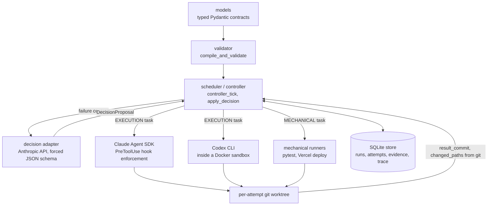

# Forge

[](https://github.com/varunhv97/forge-agent/actions/workflows/tests.yml)

Forge is a personal coding agent whose execution is governed by a strict,
code-enforced DAG. LLMs never drive the workflow: they only produce typed
proposals, and a controller validates and applies them. A run finishes when
the controller can verify the outcome from stored evidence, not when a model
says it's done.

> **Work in progress.** The core engine is built and tested, and the first
> Feature Blast slice runs end to end against a real deployment. See
> [Status](#status).

## Why

The usual way to make an LLM agent follow a process is to describe the
process in a prompt and trust the model to stick to it, including trusting
its own report that the work is finished. Forge moves that process into
code. Which task runs next, what each task is allowed to touch, when a
failure gets retried, and whether the run counts as complete are all decided
by the controller. Whether a task changed anything is read from git, and
completion is re-derived from gate evidence. A model can propose a retry or
a graph revision, but it can't skip a step or mark its own work verified.

## Core invariant

Nodes, both execution and decision, never write to the graph, their own
permissions, or run state. They return typed proposals (`DecisionProposal`,
`NodeResult`). Only `forge/controller/*` validates those proposals and turns
them into state changes.

## Architecture



| Package | Responsibility |
|---|---|
| `forge/models` | Typed contracts: requests, acceptance criteria, graph versions, attempts, evidence, decisions, permission profiles, runs, trace events. |
| `forge/controller` | The only writer of state: graph validation, the node-type registry, the SQLite store, scheduling, decision application and invalidation. |
| `forge/adapters` | Runtime integrations: Claude Agent SDK and Codex CLI for execution, the Anthropic Messages API for decisions, the Vercel REST API for deploys. |
| `forge/isolation` | Git worktree lifecycle, the PreToolUse policy engine and the Docker sandbox. |
| `forge/nodes` | Node implementations (`implement_exec`, `unit_verify_exec`, `deploy_exec`, `manual_test_exec`, ...) and `register_all()`. |
| `forge/modes` | Mode-specific graph builders. Currently only Feature Blast. |

More detail is in [architecture.md](architecture.md).

## Design points

- **Resumability.** Every attempt is written as `RUNNING` before it
  executes. Because the controller runs as a single process, any attempt
  still `RUNNING` on startup was orphaned by a crash.
  `reconcile_orphaned_attempts` cancels those attempts so the scheduler
  dispatches fresh ones. A simulated crash-and-resume is covered by tests.
- **Per-attempt worktree isolation.** Each EXECUTION attempt gets its own
  git worktree and branch. Afterwards the controller commits any leftover
  changes and diffs against the base commit, so `result_commit` and
  `changed_paths` come from git rather than from the node's own report. A
  downstream verify node runs inside the worktree it is verifying.
- **Two permission boundaries.** Claude Agent SDK attempts are constrained
  by a PreToolUse hook generated per attempt from the task's
  `PermissionProfile`. The hook runs before the SDK's own permission
  settings are consulted. The Codex CLI has no hook mechanism, so Codex
  attempts refuse to run unless they are inside a Docker container that
  mounts only that attempt's worktree.
- **Bounded decisions.** A decision node can only return one of a fixed set
  of `DecisionAction`s (retry with feedback, escalate model, propose graph
  revision, request user input, stop). `apply_decision` checks each
  proposal: a retry must cite evidence, stay within budget and not repeat
  the previous failure word for word; an escalation must name a model the
  registry allows; `STOP_SUCCESS` re-checks the gates itself. If the
  decision adapter fails, the controller falls back to deterministic
  policies.
- **Invalidation propagation.** When an accepted graph revision invalidates
  evidence, every downstream task that consumed it has its own evidence
  invalidated and its latest attempt superseded, so the scheduler re-runs
  those tasks.

## Status

v1 scope is the core engine plus one mode, **Feature Blast** (build a
bounded, additive feature end to end). Other modes are backlog only. See
[requirements.md](requirements.md).

| Milestone | State |
|---|---|
| M0: Core models and graph validator | Done |
| M1: Controller, SQLite store, mechanical nodes, resumability | Done |
| M2: Worktree isolation, Claude Agent SDK adapter, PreToolUse hooks | Done |
| M3: Decision adapter, bounded `DecisionAction`, `apply_decision` | Done |
| M4: Graph revision and invalidation propagation | Done |
| M5: Codex CLI adapter and Docker sandbox | Done (offline-tested only) |
| M6: Three-tier testing nodes, live EXECUTION dispatch | Done (live-verified) |
| M7: Feature Blast end to end with a real Vercel deployment | In progress |
| M8: CLI polish, `forge trace` / `forge inspect` | Not started |

Known gaps, as of today:

- M7 has deployed for real and the deployed endpoint returns the expected
  response. A fully green run that includes `manual_test_exec` hasn't been
  confirmed yet.
- A PreToolUse hook denying a disallowed tool call is covered by offline
  tests but hasn't been exercised in a live session yet.
- The Codex/Docker path is tested only with mocked subprocesses and has not
  been run against real binaries. Live dispatch currently uses the Claude
  Agent SDK only.
- Automatic, commit-based evidence invalidation (`invalidation.py`) is built
  and tested against real git, but it isn't wired into the scheduler yet.
- There is no CLI yet. Runs are driven from Python, as in `scripts/`.

Details for each milestone are in [tasks.md](tasks.md).

## Getting started

Requires Python 3.11+ and `git`.

```sh
python3.11 -m venv .venv
source .venv/bin/activate
pip install -r requirements-dev.txt
pytest
black --check .
ruff check .
mypy
```

`mypy` runs in strict mode over `forge/` and `scripts/`. Test bodies are
type-checked too, but test functions aren't required to be annotated.

The test suite runs fully offline. LLM, Vercel, Docker and Codex calls are
faked with `httpx.MockTransport` or mocked subprocesses. The tests that need
real git create throwaway repositories and worktrees.

### Live runs

These scripts make real model calls, so they are not part of the test suite:

- `scripts/live_smoke_test.py` runs `implement_exec → unit_verify_exec` in a
  throwaway repo through the real Claude Agent SDK. It needs an
  authenticated `claude` CLI session or `ANTHROPIC_API_KEY`.
- `scripts/live_feature_blast_m7.py` runs the full Feature Blast slice
  (`implement_exec → unit_verify_exec → deploy_exec → manual_test_exec`),
  deploys to a real Vercel project and then checks the live URL itself. It
  needs the same Claude authentication plus a Full Account-scoped
  `VERCEL_TOKEN` in `.env.local`.

Both scripts use the controller's deterministic fallback policies for
decisions rather than live decision-adapter calls.

## Further reading

- [requirements.md](requirements.md): scope and key decisions
- [architecture.md](architecture.md): modules, enforcement and data flow
- [tasks.md](tasks.md): milestone roadmap and known gaps

## License

[MIT](LICENSE)
